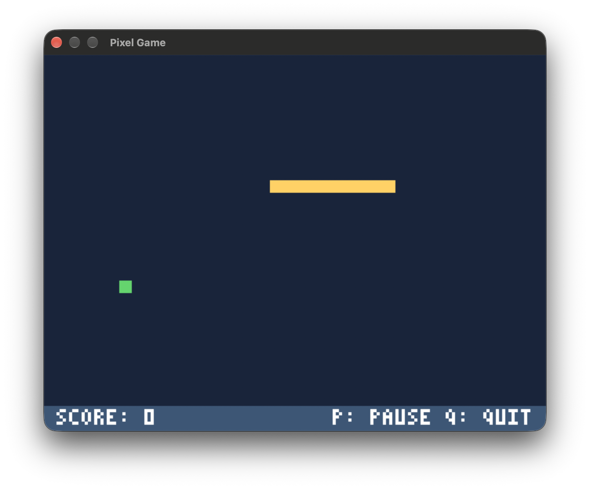

# Pixel Game

A small C11 snake game using [Fenster](https://github.com/zserge/fenster) for the window, framebuffer, input and timing. It draws at 160 × 120, scaling each pixel 4×, with a 40 × 28 playing grid and a score and controls bar below it.

## How to play

- Use the arrow keys to steer the snake toward the green food. Eating adds one segment, briefly turns the snake red, and increases its speed and score.
- The snake wraps around the edges; direct reversals are ignored. Moving into any occupied body cell, including the current tail position, ends the game. Filling the board also ends the game.
- Press P to pause or resume, R to restart after the game ends, and Q or Escape to quit. The screen flashes red three times when the game ends.

The snake starts with a head and nine body segments. Change `BODY_SEGMENTS` in `src/game.h` to adjust its initial body length. Each food item reduces the movement interval by 1 ms, from 70 ms to a minimum of 30 ms. Its score is the difference between the initial and new interval, so successive items are worth 1 through 40 points, then 40 points each.

When a game ends, its score is appended as a number on its own line to `snake_highscores.txt` in the current working directory. If the file cannot be written, an error is reported and the game continues.

## Requirements

- A C11 compiler and Make. VS Code and its C/C++ and CodeLLDB extensions are optional for the provided editor tasks and debugger configurations.
- macOS: Xcode Command Line Tools (`xcode-select --install`) for the SDK and Cocoa framework. Apple's `/usr/bin/gcc` is Clang; install GCC separately (for example, `brew install gcc`) if you require GCC. Homebrew names it with a version, such as `gcc-15`.
- Linux: X11 development headers and libraries (for example, `libx11-dev` on Debian/Ubuntu), GCC, Make and GDB for the GDB launch configuration.
- Windows: MinGW-w64 GCC and a Unix-like shell with Make, such as MSYS2. The provided debugger configurations target macOS and Linux; adjust the executable path and debugger for Windows.

## Build and run

```sh
make
make run
make clean
```

The compiler defaults to `gcc`. If GCC has a versioned name, use `make CC=gcc-15` (substitute your installed version), or set `CC` in your environment for VS Code tasks as well. The executable is `build/pixel-game` (`.exe` on Windows).

Open this folder in VS Code. Use **Terminal → Run Build Task** to build, **Terminal → Run Task → run** to run, or F5 and select the LLDB configuration on macOS or GDB on Linux. Start VS Code with `CC` set if your GCC has a versioned name. The C/C++ extension can select the same compiler through its IntelliSense configuration.

## Project structure

`src/main.c` manages the window, input, framebuffer and main loop. `src/game.c` coordinates game state, movement, scoring and drawing; `src/snake.c` and `src/food.c` manage the snake and food. `src/draw.c` and `src/font.c` provide framebuffer drawing and text. The Makefile automatically includes `.c` and `.h` files in `src`.

Fenster is vendored in `vendor/fenster`, with its MIT license, from upstream commit `e700581dfb7956dd161aee44fc0cff0663e789a1`.
